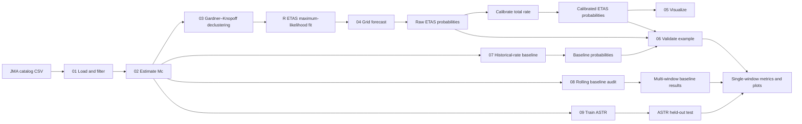
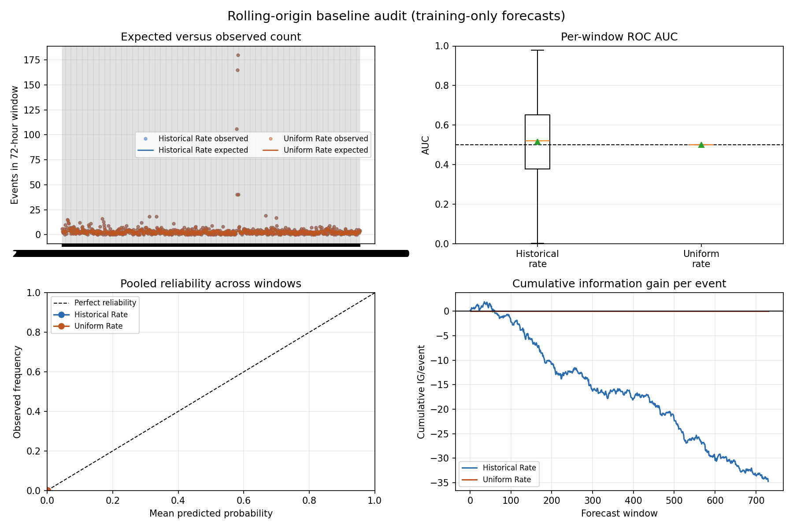
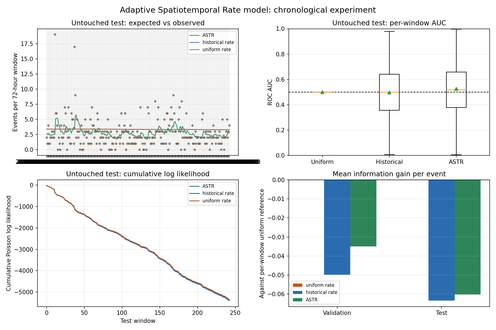
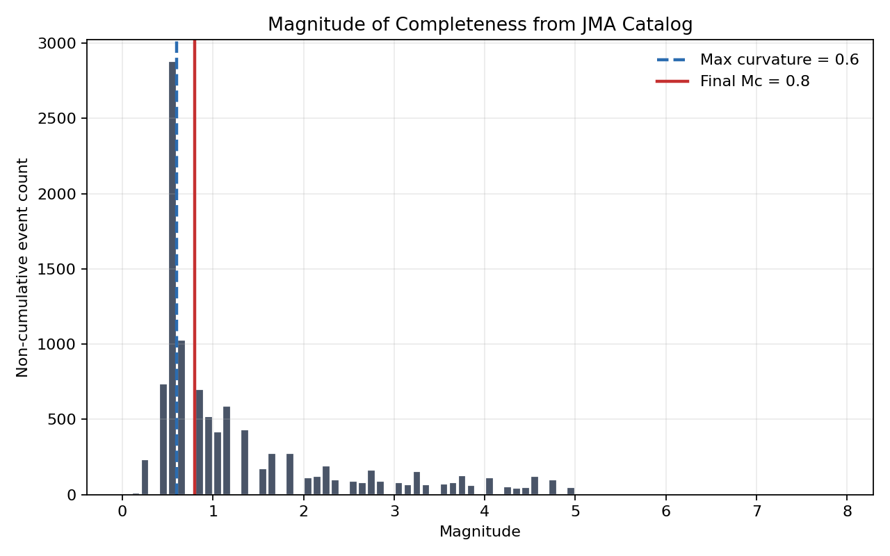
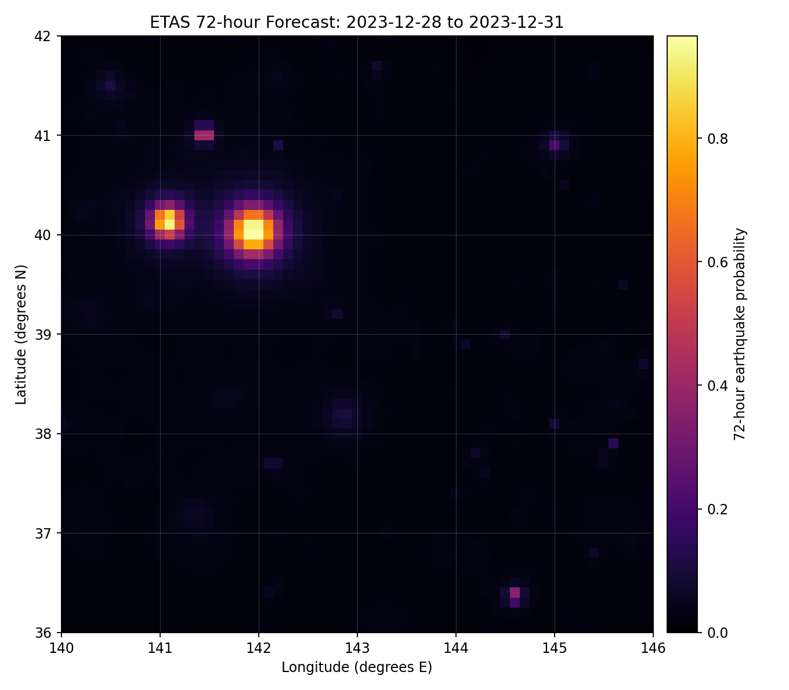
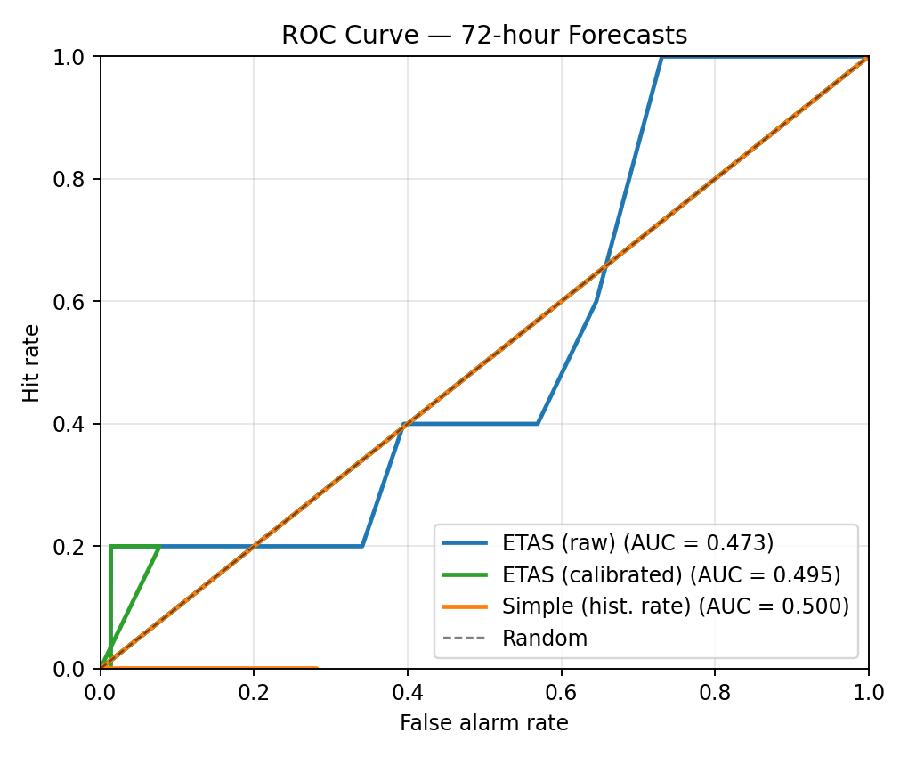
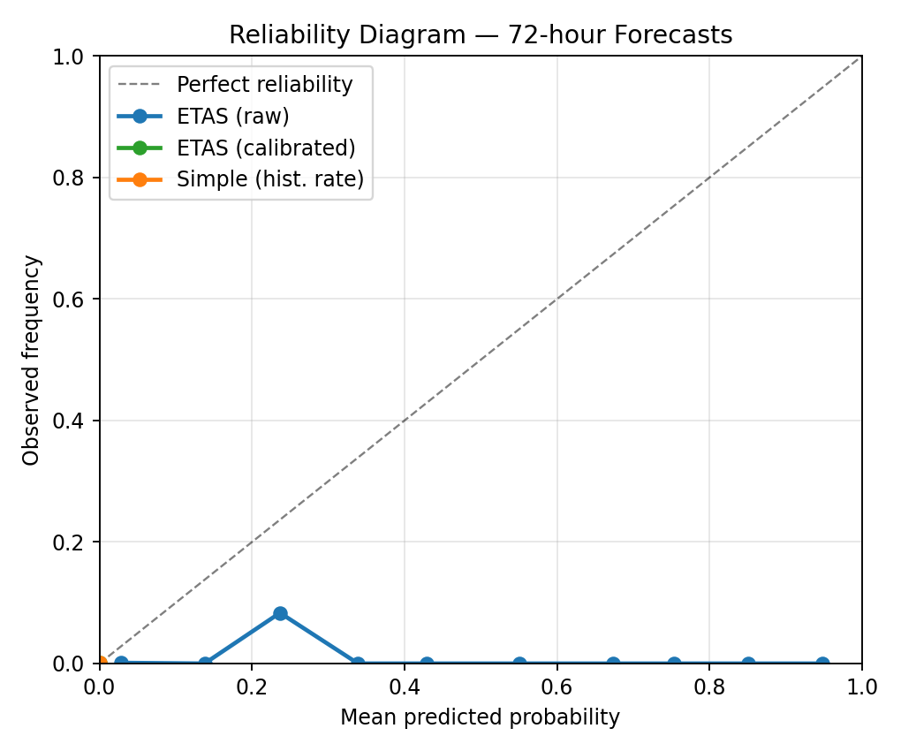
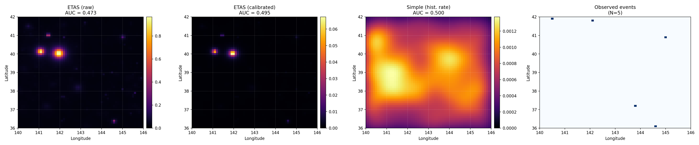

# JMA ETAS Benchmark

**A transparent, reproducible 72-hour earthquake-forecasting benchmark for the offshore Tohoku/Kanto region of Japan.**

This repository turns a JMA earthquake catalog into a spatial probability map, compares an ETAS model with a historical-rate baseline, and records the assumptions and diagnostics needed to interpret the result.

> **Important:** this is a research benchmark and reproducibility project, not an operational warning system. The checked-in result evaluates one retrospective 72-hour window. It must not be used alone for emergency decisions or public safety.

[](METHODS.md)
[](https://www.data.jma.go.jp/svd/eqev/data/bulletin/hypo_e.html)
[](LICENSE)

## Start here

| If you want to… | Read this |
|---|---|
| Understand the project in five minutes | This page |
| Run the pipeline from a fresh checkout | [`docs/GETTING_STARTED.md`](docs/GETTING_STARTED.md) |
| See how data and scripts connect | [`docs/ARCHITECTURE.md`](docs/ARCHITECTURE.md) |
| Interpret the existing charts and scores | [`docs/BENCHMARKS.md`](docs/BENCHMARKS.md) |
| Read the research basis and new findings | [`docs/RESEARCH.md`](docs/RESEARCH.md) |
| Understand and reproduce the trained ASTR model | [`docs/MODEL.md`](docs/MODEL.md) |
| Review the mathematical and scientific details | [`METHODS.md`](METHODS.md) |

## What problem does it solve?

Earthquakes cluster in time and space: a larger event can be followed by aftershocks, and some areas have a higher long-term rate than others. The project asks:

> Given the catalog up to a forecast time, what is the probability of at least one earthquake in each 0.1° × 0.1° grid cell during the next 72 hours?

It compares two useful perspectives:

- **ETAS:** models background seismicity plus short-term triggering from previous events.
- **Historical-rate baseline:** smooths the long-term spatial event density without modeling triggering.
- **ASTR:** a trainable, interpretable adaptive model that combines long-term spatial density with recent activity. It is ETAS-inspired, but not a replacement for full ETAS.

The forecast is a probability surface, not a deterministic prediction of the next earthquake. The checked-in ETAS comparison is a single-window demonstration; the new rolling audit measures only training-safe simple baselines until a full origin-by-origin ETAS refit is implemented.

## Project at a glance

| Item | Current benchmark configuration |
|---|---|
| Study region | 36–42°N, 140–146°E (offshore Tohoku/Kanto) |
| Catalog period | 2010–2023 |
| Catalog source | JMA Unified Hypocenter Catalog |
| Completeness threshold | Mc = 0.8 (maximum curvature 0.6 + 0.2 conservative offset) |
| Forecast horizon | 72 hours |
| Forecast grid | 0.1° spacing; 61 × 61 grid coordinates |
| ETAS fit | R `ETAS` package; Python evaluates the exported parameters on the grid |
| Validation | Poisson log-likelihood, N-test, information gain, ROC/AUC, reliability diagram |
| Rolling audit | 730 non-overlapping 72-hour origins from 2018-01-01 to 2023-12-28; training-only historical and uniform baselines |
| ASTR experiment | 487 validation origins for tuning; 243 untouched 2022–2023 test origins |
| Checked-in validation window | 2023-12-28 03:13:21 to 2023-12-31 03:13:21 UTC-like catalog timestamps |
| Observations in that window | 5 events at or above Mc |

## Architecture in one picture



For a larger data-lineage diagram, artifact contract, and explanation of the Python/R boundary, see [`docs/ARCHITECTURE.md`](docs/ARCHITECTURE.md).

## Pipeline steps

| Step | Script | What it does | Main output |
|---:|---|---|---|
| 1 | `src/01_load_and_filter.py` | Standardizes the JMA CSV and applies time/region filters | `data/processed/catalog_region_2010_2023.csv` |
| 2 | `src/02_estimate_mc.py` | Estimates magnitude of completeness and removes less-complete events | `catalog_mc_filtered.csv`, `mc_estimate.txt`, FMD graph |
| 3 | `src/03_decluster.py` | Labels dependent events with Gardner–Knopoff windows | `mainshocks_gk.csv`, `aftershocks_gk.csv` |
| 4 | `etas/fit_etas.R` | Fits eight ETAS parameters with the R `ETAS` package | `etas_parameters.csv`, `etas_fit.rds` |
| 5 | `src/04_etas_forecast.py` | Evaluates the fitted intensity on the 0.1° grid | `forecast_prob_72h.npy`, grid metadata |
| 6 | `src/calibrate_etas.py` | Applies a documented rate-matching correction to the raw grid | calibrated grid and metadata |
| 7 | `src/07_simple_forecast.py` | Builds a smoothed long-term spatial-rate baseline | `simple_prob_72h.npy`, baseline metadata |
| 8 | `src/05_visualize.py` | Draws the ETAS forecast and observed events | `figures/forecast_map_72h.png` |
| 9 | `src/06_validate.py` | Scores the example forecasts against observations | single-window metrics and diagnostic graphs |
| 10 | `src/08_rolling_backtest.py` | Scores training-only baselines over non-overlapping origins | rolling CSV/JSON results and audit graph |
| 11 | `src/09_train_adaptive_model.py` | Tunes ASTR on 2018–2021 and evaluates untouched 2022–2023 origins | model config, held-out scores, and comparison graph |

Run all eleven stages in order with `bash run_pipeline.sh`. The scripts fail early when a required input is missing; the raw catalog is intentionally not committed to this repository.

## Benchmark snapshot

The checked-in artifacts are a **single-window demonstration**, not a statistically sufficient long-term evaluation. The most important signal is the difference between raw and calibrated event counts:

| Forecast | Expected events | Observed events | N-test | Log-likelihood | ROC AUC |
|---|---:|---:|---|---:|---:|
| ETAS (raw) | 159.43 | 5 | **FAIL** | -175.70 | 0.473 |
| ETAS (calibrated) | 3.29 | 5 | **PASS** | **-38.96** | 0.495 |
| Historical-rate baseline | 3.01 | 5 | **PASS** | -40.91 | 0.500 |

The calibration fixes the total-rate mismatch in this example, but it does **not** create spatial skill: all AUC values are close to random with only five observed events. The new rolling audit provides a more honest baseline reference without using future events:

| Rolling model | Origins | Total expected | Total observed | Aggregate N-test | Window N-test pass rate | Mean AUC | Mean IG/event |
|---|---:|---:|---:|:---:|---:|---:|---:|
| Historical-rate baseline | 730 | 2,332.79 | 2,661 | **FAIL** | 94.9% | 0.515 | -0.0528 |
| Uniform-rate baseline | 730 | 2,341.36 | 2,661 | **FAIL** | 94.9% | 0.500 | 0.0000 |

The multi-window result shows that the smoothed spatial baseline had only a small average ranking advantage and negative information gain relative to the per-window uniform reference, while both baselines underpredicted the aggregate count. This is useful evidence for the next model iteration, not evidence that ETAS succeeds or fails: the rolling script intentionally does not refit ETAS at each origin.



The calibration fixes the total-rate mismatch in the single-window example, but it does **not** create spatial skill. A reliable ETAS research claim requires rolling-window refits with training-only data; that remains the next implementation stage.

## ASTR held-out model experiment

`src/09_train_adaptive_model.py` trains the **Adaptive Spatiotemporal Rate (ASTR)** model using only 2018–2021 validation origins, freezes its configuration, and evaluates 2022–2023 as an untouched test. It compares all models on the same 243 test origins and the same 60×60 grid contract.

| Model | Test origins | Expected events | Observed events | Aggregate N-test | Mean log likelihood | Mean AUC | Mean IG/event |
|---|---:|---:|---:|:---:|---:|---:|---:|
| Uniform rate | 243 | 814.49 | 650 | **FAIL** | -22.027 | 0.500 | ~0.0000 |
| Historical rate | 243 | 814.49 | 650 | **FAIL** | -22.258 | 0.498 | -0.0634 |
| **ASTR** | 243 | 691.08 | 650 | **PASS** | **-22.164** | **0.527** | **-0.0602** |

ASTR beats the repository's historical-rate baseline on held-out total log likelihood by **23.01** and improves mean AUC by **0.028**. It also passes the aggregate N-test. It does **not** beat the uniform-rate baseline on total log likelihood, so the result is a partial improvement—not proof that ASTR is the best earthquake model.



The selected configuration and full tuning table are stored in `data/outputs/adaptive_model_config.json` and `data/outputs/adaptive_model_tuning.csv`. The complete per-window result is in `data/outputs/adaptive_backtest_windows.csv`.

ASTR is not a direct comparison against USGS OAF or UCERF3-ETAS. Those operational ETAS systems use different catalogs, regions, target magnitudes, and evaluation protocols. A fair direct comparison requires an origin-safe rolling ETAS refit on the same JMA experiment.

### Visual results

Magnitude completeness estimate:



Forecast map:



Validation diagnostics:

| ROC discrimination | Reliability | Forecast versus observations |
|---|---|---|
|  |  |  |

Detailed interpretation, the rolling findings, and a metric glossary are in [`docs/BENCHMARKS.md`](docs/BENCHMARKS.md). The research basis and design decisions are in [`docs/RESEARCH.md`](docs/RESEARCH.md).

## Quick start

### Docker (recommended for the complete Python + R pipeline)

```bash
# 1. Put the downloaded JMA CSV at:
#    data/raw/jma_tohoku_2010_2023.csv

# 2. Build and run the complete pipeline
docker compose build
docker compose run --rm jma-etas-benchmark
```

For a longer ETAS optimization, increase the iteration count. The default is intentionally a quick reproducibility run:

```bash
docker compose run --rm -e ETAS_NO_ITR=300 jma-etas-benchmark
```

### Local Python + R

Requirements are Python 3.10+, R 4.2+, and the R package `ETAS`:

```bash
python3 -m venv .venv
source .venv/bin/activate
pip install -r requirements.txt
Rscript -e "install.packages('ETAS', repos='https://cloud.r-project.org')"
bash run_pipeline.sh
```

The expected input columns and individual-step commands are documented in [`docs/GETTING_STARTED.md`](docs/GETTING_STARTED.md).

## How to read the outputs

| Directory | Contents | Why it matters |
|---|---|---|
| `data/raw/` | User-provided JMA CSV; ignored by Git | Source data stays separate from derived artifacts |
| `data/processed/` | Cleaned, Mc-filtered, and declustered catalogs | Auditable inputs to fitting and evaluation |
| `data/outputs/` | Parameters, NumPy grids, metadata, and metrics | Machine-readable results and provenance |
| `data/outputs/rolling_backtest_*` | Rolling baseline results | Training-only baseline research results |
| `data/outputs/adaptive_model_config.json` | Frozen ASTR parameters and protocol | Reproducible trained model |
| `data/outputs/adaptive_model_tuning.csv` | Validation-only candidate scores | Hyperparameter selection audit |
| `data/outputs/adaptive_backtest_*` | ASTR per-window, summary, and reliability results | Held-out model evaluation |
| `figures/` | PNG graphs generated by the pipeline | Human-readable diagnostics and communication |
| `src/` | Python preprocessing, forecasting, validation, visualization | Main executable workflow |
| `etas/` | R ETAS fit and optional compatibility wrapper | Model fitting boundary |
| `scripts/` | Utilities for combining/converting local JMA files | Data preparation helpers |

Forecast grids are NumPy arrays; use the accompanying `*_metadata.json` file for coordinates, time window, grid spacing, and effective parameters. Do not interpret an array without its metadata.

## Scientific scope and limitations

This project is useful for learning, reproducibility, and controlled model comparison. It is not yet an operational forecasting service. Current limitations include:

1. The legacy ETAS comparison remains a single 72-hour window with only five observed events; ASTR has a held-out 2022–2023 test but is not a full rolling ETAS refit.
2. The Mc estimate is global for the region, although detection completeness can vary with location and time.
3. Gardner–Knopoff is a simple deterministic declustering method; it does not quantify parentage uncertainty.
4. ASTR is ETAS-inspired and interpretable, but it does not explicitly estimate branching or parent-child triggering.
5. The calibrated legacy ETAS result uses full-catalog rate information and is not prospective.
6. The project does not provide uncertainty intervals, real-time ingestion, alert thresholds, or emergency decision support.

See [`METHODS.md`](METHODS.md) for equations and assumptions, [`docs/BENCHMARKS.md`](docs/BENCHMARKS.md) for the evidence currently available, and the [JMA catalog documentation](https://www.data.jma.go.jp/svd/eqev/data/bulletin/hypo_e.html) for data provenance.

## Repository map

```text
jma-etas-benchmark/
├── README.md                         # Project overview and navigation
├── docs/
│   ├── GETTING_STARTED.md            # Run guide and input/output contract
│   ├── ARCHITECTURE.md               # Visual system and data-flow guide
│   ├── BENCHMARKS.md                 # Single-window, rolling, and ASTR results
│   ├── MODEL.md                      # ASTR architecture and training protocol
│   └── RESEARCH.md                   # External research and design decisions
├── METHODS.md                        # Detailed methodology and limitations
├── run_pipeline.sh                   # Eleven-step orchestration script
├── src/                              # Python preprocessing, forecasts, plots, validation
│   ├── adaptive_spatiotemporal.py    # ASTR model implementation
│   └── 09_train_adaptive_model.py    # Chronological training/test experiment
├── etas/                             # R ETAS fitting scripts
├── scripts/                          # Catalog preparation utilities
├── data/
│   ├── raw/                          # Place the JMA CSV here (not committed)
│   ├── processed/                    # Derived catalogs
│   └── outputs/                      # Forecast arrays, metadata, metrics
└── figures/                          # Generated PNG diagnostics
```

## Roadmap

- Rolling baseline audit with explicit training-only origins **(implemented)**
- ASTR adaptive model with untouched 2022–2023 test **(implemented)**
- Rolling ETAS refits with precise origin cutoffs **(next reliability milestone)**
- Better spatial/temporal completeness analysis
- Additional baselines and prospective calibration
- Multi-region benchmark configuration
- Interactive visualization for exploration (not for replacing scientific validation)

## Citation

```bibtex
@misc{jma-etas-benchmark,
  title = {JMA ETAS Benchmark: Reproducible 72-hour Earthquake Forecasting},
  author = {Bala Chandra Sekhar Reddy Moole},
  year = {2026},
  note = {Open-source reproducible benchmark for ETAS-based earthquake forecasting},
  url = {https://github.com/bala2006/jma-etas-benchmark}
}
```

Also cite the JMA Unified Hypocenter Catalog, Ogata (1988), and Gardner & Knopoff (1974); see [`CITATION.bib`](CITATION.bib).
