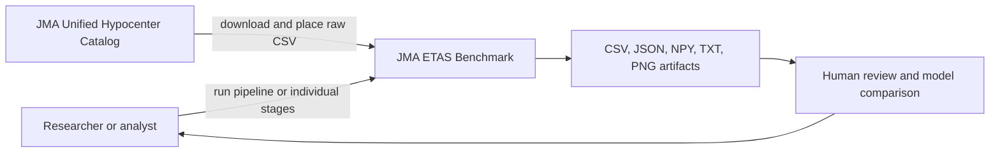
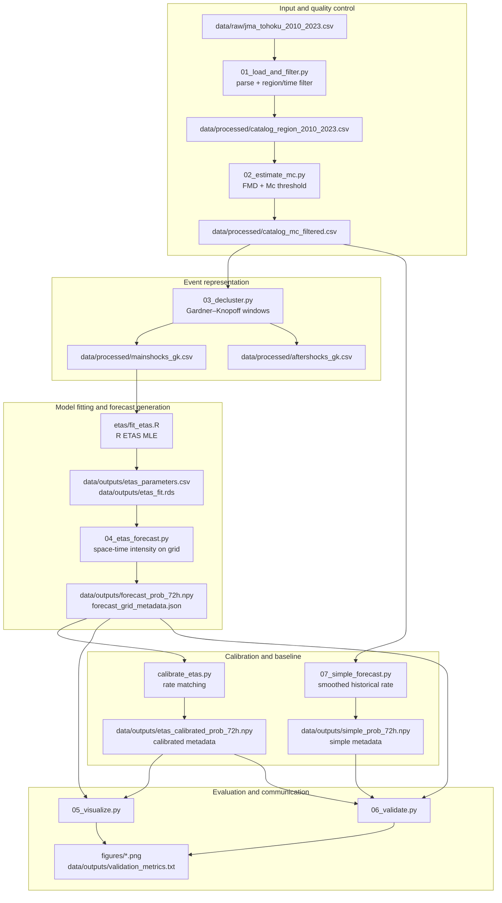

# Architecture and data flow

This page explains how the repository is organized, what each boundary produces, and how a catalog row becomes a probability on a map.

## System context



The repository is an offline batch benchmark. It does not fetch live events, host an API, issue alerts, or make a claim about earthquake predictability beyond the measured benchmark outputs.

## End-to-end pipeline



## Pipeline contract

Each stage has a simple contract: read a named artifact, perform one scientifically identifiable operation, and write a named artifact. This makes the pipeline inspectable without opening every script.

| Boundary | Input | Transformation | Output | Failure meaning |
|---|---|---|---|---|
| Ingestion | Raw JMA CSV | Parse and validate required columns | Regional CSV | Input file or schema is missing |
| Completeness | Regional CSV | Histogram-based maximum curvature + offset | Mc-filtered CSV and report | No usable magnitudes |
| Declustering | Mc-filtered CSV | Magnitude-dependent time/distance windows | Mainshock and aftershock CSVs | No filtered catalog |
| R/Python model boundary | Mainshocks CSV | R `ETAS` fit exports named parameters | Parameter CSV and RDS | R package, fit, or input issue |
| Grid forecast | Parameters + mainshocks | Conditional intensity → Poisson probability | `.npy` grid + JSON metadata | Parameters or event catalog missing |
| Calibration | Raw grid + filtered catalog | Historical-rate scaling | Calibrated grid + metadata | Invalid or zero predicted rate |
| Baseline | Filtered catalog | Smoothed spatial histogram | Baseline grid + metadata | Catalog has no usable time span |
| Validation | Forecast grids + metadata + catalog | Count events, score forecasts, plot diagnostics | Metrics and PNGs | Forecasts have incompatible geometry/time |

## Why Python and R are both present

- **Python** owns ingestion, filtering, Mc estimation, declustering, grid evaluation, calibration, baseline generation, visualization, and validation.
- **R** owns the maximum-likelihood ETAS fit through the CRAN `ETAS` package.
- The handoff is deliberately small: `fit_etas.R` writes `etas_parameters.csv`, and Python reads that table. The full R object is also saved as `etas_fit.rds` for inspection.

`etas/generate_forecast.R` is retained as an optional compatibility note because prediction helper APIs vary across versions of the R package. The reproducible grid path is `src/04_etas_forecast.py`.

## Model view

The conditional intensity is conceptually:

```text
lambda(t, x, y) = background(x, y)
                 + sum over previous events i of triggering_i(t, x, y, magnitude_i)
```

The triggering term combines:

```mermaid
flowchart LR
    M[Previous magnitude Mᵢ] --> P[Productivity\nA exp(alpha(Mᵢ-M0))]
    T[Elapsed time t-tᵢ] --> O[Omori decay\n(t-tᵢ+c)^(-p)]
    X[Distance from event] --> S[Spatial decay\n(1+r²/D·scale)^(-q)]
    P --> G[Triggering contribution gᵢ]
    O --> G
    S --> G
    G --> I[Conditional intensity λ]
    B[Background rate μ] --> I
```

The grid evaluator integrates the intensity over 3 days and converts the expected count in each cell to:

```text
P(at least one event) = 1 - exp(-expected_count)
```

The eight exported parameters are `mu`, `A`, `c`, `alpha`, `p`, `D`, `q`, and `gamma`. Their definitions and units are documented in [`../METHODS.md`](../METHODS.md).

## Artifact layout and provenance

```text
data/
├── raw/                  # User-supplied source CSV; not committed
├── processed/            # Deterministic catalog transformations
└── outputs/              # Model, forecast, metadata, and validation artifacts

figures/                  # Human-readable PNG diagnostics
src/                      # Python stages
etas/                    # R fitting boundary
scripts/                  # Catalog preparation helpers
```

For every probability grid, the matching JSON metadata records:

- latitude and longitude coordinate arrays;
- forecast start and end timestamps;
- grid spacing and window length;
- parameter source and effective parameters;
- calibration details where applicable.

This pairing is an important safety rule: a `.npy` array without its metadata cannot be interpreted correctly.

## Operational boundary

The current architecture is appropriate for an offline research benchmark. A real-world operational service would additionally need:

1. automated, monitored catalog ingestion with duplicate and late-arriving-event handling;
2. versioned configuration and data snapshots;
3. prospective rolling-origin evaluation, not only retrospective demonstration;
4. uncertainty intervals and calibration monitoring;
5. reproducible packaging of exact Python/R/system dependencies;
6. access control, audit logs, alert policy, and human review;
7. explicit governance for how forecasts may and may not be used.

Those requirements are intentionally outside the current scope. Documenting the boundary prevents a benchmark from being mistaken for a production warning system.
