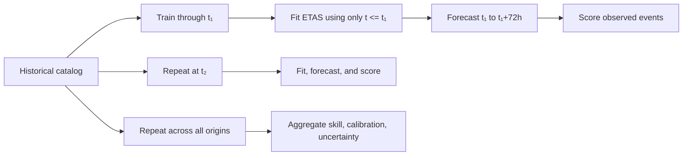

# Benchmark report

This page explains what the checked-in numbers mean, where they came from, and what they do **not** establish.

## Executive summary

The repository includes two complementary evaluations:

1. a **single-window retrospective ETAS demonstration** retained for the forecast map and model illustration; and
2. a **730-origin rolling baseline audit** that uses only training data available at each origin and scores two simple reference models.

Both evaluations use the same broad scope: **region 36–42°N, 140–146°E; JMA events from 2010–2023; Mc = 0.8; and a 72-hour horizon**. The original ETAS window is `2023-12-28 03:13:21` through `2023-12-31 03:13:21` with 5 observed events at or above Mc. The rolling audit uses non-overlapping origins from `2018-01-01` through `2023-12-28`.

The ETAS fit predicts 159.43 events in the original 72-hour window, while the historical-rate calibration expects 3.29 and the original baseline expects 3.01. The calibrated model therefore passes that example N-test while the raw model fails. However, the spatial AUC values are approximately 0.5, and five observations are not enough to support a strong ETAS performance claim.

The new rolling audit is the more reliable result for the simple baselines: over 730 non-overlapping windows, the historical-rate baseline has mean AUC 0.515 and mean information gain/event -0.0528 versus the per-window uniform reference. Both baselines underpredict the aggregate count. This audit does **not** refit ETAS, so it is not a rolling ETAS result.

## Reproducing the report

Run the complete pipeline after placing the raw JMA CSV at `data/raw/jma_tohoku_2010_2023.csv`:

```bash
bash run_pipeline.sh
```

The report is generated from:

- `data/outputs/validation_metrics.txt`
- `data/outputs/rolling_backtest_windows.csv`
- `data/outputs/rolling_backtest_summary.json`
- `data/outputs/rolling_backtest_reliability.json`
- `data/outputs/mc_estimate.txt`
- `data/outputs/*_grid_metadata.json`
- `figures/*.png`

The rolling audit can also be run directly with:

```bash
python3 src/08_rolling_backtest.py
```

The generated files checked into the repository are a reference snapshot. If you use a different catalog, fit configuration, R package version, or iteration count, your values may differ.

## Data reduction and forecast scope

| Stage | Events |
|---|---:|
| Regional catalog before Mc filtering | 10,495 |
| Events retained at Mc ≥ 0.8 | 5,608 |
| Gardner–Knopoff mainshocks | 4,682 |
| Gardner–Knopoff aftershocks | 926 |
| Events in checked-in validation window | 5 |

The Mc figure shows why the threshold matters:


The current estimate is maximum curvature at 0.6 plus a 0.2 offset. It is a global regional threshold, not a time-varying or spatially varying detection model.

## Main benchmark table

Values below are read from `data/outputs/validation_metrics.txt`.

| Forecast | Expected events | Observed events | 95% N-test interval | N-test | Poisson log-likelihood | Uniform log-likelihood | Information gain/event | ROC AUC |
|---|---:|---:|---:|:---:|---:|---:|---:|---:|
| ETAS (raw) | 159.43 | 5 | 135–185 | **FAIL** | -175.70 | -175.18 | -0.1038 | 0.473 |
| ETAS (calibrated) | 3.29 | 5 | 0–7 | **PASS** | **-38.96** | -38.44 | -0.1038 | 0.495 |
| Historical-rate baseline | 3.01 | 5 | 0–7 | **PASS** | -40.91 | -38.61 | -0.4601 | 0.500 |

### How to interpret the table

- **Expected events** is the sum of per-cell Poisson expected counts over the forecast grid. It is not the number of cells with high probability.
- **Observed events** is the count in the forecast window after applying Mc.
- **N-test** asks whether the observed count falls inside the model's 95% Poisson interval. It evaluates total rate, not location.
- **Poisson log-likelihood** rewards forecasts that assign appropriate probability mass to the observed cell counts. Higher is better; comparisons are meaningful only on the same grid, threshold, and window.
- **Information gain/event** compares the model likelihood with a uniform spatial forecast. Negative values mean the model did not improve on that reference in this window.
- **ROC AUC** measures ranking of cells with at least one observed event. 0.5 is random ranking; it is unstable with very few positive cells.

## Benchmark visualizations

### Forecast map


The map shows the probability surface produced by the ETAS grid evaluator. The outlined points are observed M4+ events in the forecast window; the evaluation itself uses all events at or above Mc.

### Discrimination and reliability

| ROC curve | Reliability diagram |
|---|---|
|  |  |

The ROC curve describes ranking performance, not whether the probabilities are numerically calibrated. The reliability diagram compares predicted probability bins with observed event frequency, but one window provides too little data for a stable calibration assessment.

### Forecasts versus observations


This comparison is useful for a visual sanity check: it shows the spatial pattern assigned by each forecast alongside the observed event counts. It should not be read as proof that one map will generalize to future windows.

## Rolling baseline audit

The single-window ETAS table above remains useful as a reproducible illustration, but it is not enough for a reliability claim. `src/08_rolling_backtest.py` adds a stricter baseline experiment:

- **730 origins** every three days from 2018-01-01 through 2023-12-28;
- a **72-hour horizon** with no overlapping windows;
- training events restricted to `datetime <= origin`;
- scored events restricted to `origin < datetime <= origin + 72 hours`;
- 60×60 forecast cells represented by 61×61 coordinate edges;
- two baselines: smoothed historical rate and uniform rate;
- per-window scores plus aggregate likelihood, N-test, AUC distribution, Brier score, and pooled reliability.

| Rolling model | Origins | Total expected | Total observed | Aggregate N-test | Window N-test pass rate | Mean AUC | Mean IG/event |
|---|---:|---:|---:|:---:|---:|---:|---:|
| Historical-rate baseline | 730 | 2,332.79 | 2,661 | **FAIL** | 94.9% | 0.515 | -0.0528 |
| Uniform-rate baseline | 730 | 2,341.36 | 2,661 | **FAIL** | 94.9% | 0.500 | ~0.0000 |


The spatial baseline's average AUC is only slightly above random, its fifth-percentile AUC is 0.167, and its average information gain is negative relative to the per-window uniform reference. Both baselines underpredict the aggregate count. The useful research finding is therefore not that the historical map is operationally reliable; it is that a simple long-term spatial rate does not adequately capture this catalog's short-horizon variation.

This output is intentionally **not** labeled a rolling ETAS result. The script does not refit R ETAS parameters at each origin, so it cannot establish prospective ETAS skill. See [`RESEARCH.md`](RESEARCH.md) for the design rationale and the next ETAS milestone.

## What the calibration does

`src/calibrate_etas.py` uses the long-term filtered catalog rate to scale the raw forecast:

```text
scale = historical_expected_72h / raw_predicted_72h
calibrated_intensity = raw_intensity × scale
```

The parameter CSV also writes a scaled `mu` for traceability, but the stored calibrated grid is produced by scaling the entire integrated intensity. It is explicitly marked as non-prospective in its metadata.

For this snapshot:

| Quantity | Value |
|---|---:|
| Historical catalog events | 5,608 |
| Catalog span | 5,111.3 days |
| Historical daily rate | 1.0972 events/day |
| Raw 72-hour expected count | 159.43 |
| Calibrated 72-hour expected count | 3.29 |
| Scale factor | 0.0206 |

This is useful for exposing the effect of rate mismatch and making a controlled comparison. It is not a learned prospective calibration model: the historical rate includes information from the full catalog and the result is evaluated in the same overall study period.

## What this benchmark can and cannot say

### Supported conclusions

- The simple historical-rate baseline has been evaluated over 730 training-only, non-overlapping windows.
- Long-term spatial smoothing alone has only modest average ranking skill and negative mean information gain versus the uniform reference in this snapshot.
- Both simple baselines underpredict the aggregate event count, so total-rate behavior also needs improvement.
- The raw ETAS output is severely overdispersed in the original single-window demonstration.
- Rate matching changes the single-window total-count behavior and makes that example N-test pass.
- ETAS should not be considered useful unless a true rolling ETAS evaluation improves on these baselines.

### Unsupported conclusions

- That ETAS can reliably predict a specific earthquake.
- That the calibrated model is operationally calibrated.
- That the rolling baseline audit establishes ETAS performance; ETAS was not refit at each origin.
- That an AUC near 0.5 proves ETAS has no value in general.
- That the single-window result is a statistically adequate benchmark.
- That the rolling result generalizes to another catalog, region, or magnitude threshold.
- That the maps should be used for evacuation, public warning, or emergency response.

## Next research milestone: rolling ETAS

The current code provides a valid rolling baseline schedule. The next step is a true rolling ETAS experiment:



A stronger evaluation should:

1. choose forecast origins before looking at future events;
2. fit or update ETAS using only data available at each origin;
3. score many non-overlapping or clearly accounted-for windows;
4. report uncertainty intervals across windows;
5. compare ETAS with the historical baseline and simple count-rate models;
6. monitor N-test, likelihood, calibration, and spatial discrimination separately.

The external research basis for these choices is summarized in [`RESEARCH.md`](RESEARCH.md), including links to CSEP, pyCSEP, the prospective California benchmark, and ETAS completeness research.
