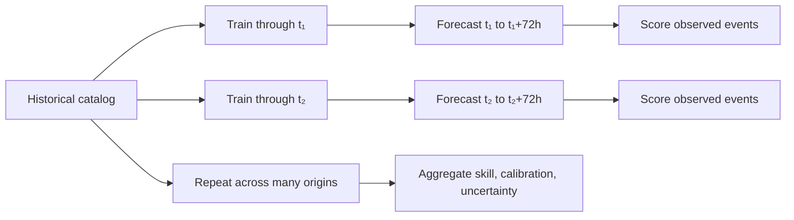

# Benchmark report

This page explains what the checked-in numbers mean, where they came from, and what they do **not** establish.

## Executive summary

The repository includes one reproducible 72-hour retrospective comparison:

- **Region:** 36–42°N, 140–146°E.
- **Catalog:** JMA events from 2010–2023.
- **Completeness threshold:** Mc = 0.8.
- **Forecast window:** `2023-12-28 03:13:21` through `2023-12-31 03:13:21`.
- **Observed events:** 5 events at or above Mc.
- **Compared forecasts:** raw ETAS, rate-calibrated ETAS, and a smoothed historical-rate baseline.

The raw ETAS fit predicts 159.43 events in the 72-hour window, while the historical-rate calibration expects 3.29 and the baseline expects 3.01. The calibrated model therefore passes the example N-test while the raw model fails. However, the spatial AUC values are approximately 0.5, and five observations are not enough to support a strong claim of spatial forecasting skill.

## Reproducing the report

Run the complete pipeline after placing the raw JMA CSV at `data/raw/jma_tohoku_2010_2023.csv`:

```bash
bash run_pipeline.sh
```

The report is generated from:

- `data/outputs/validation_metrics.txt`
- `data/outputs/mc_estimate.txt`
- `data/outputs/*_grid_metadata.json`
- `figures/*.png`

The generated files checked into the repository are a reference snapshot. If you use a different catalog, fit configuration, R package version, or iteration count, your values may differ.

## Data reduction and forecast scope

| Stage | Events |
|---|---:|
| Regional catalog before Mc filtering | 10,495 |
| Events retained at Mc ≥ 0.8 | 5,608 |
| Gardner–Knopoff mainshocks | 4,682 |
| Gardner–Knopoff aftershocks | 926 |
| Events in checked-in validation window | 5 |

The Mc figure shows why the threshold matters:


The current estimate is maximum curvature at 0.6 plus a 0.2 offset. It is a global regional threshold, not a time-varying or spatially varying detection model.

## Main benchmark table

Values below are read from `data/outputs/validation_metrics.txt`.

| Forecast | Expected events | Observed events | 95% N-test interval | N-test | Poisson log-likelihood | Uniform log-likelihood | Information gain/event | ROC AUC |
|---|---:|---:|---:|:---:|---:|---:|---:|---:|
| ETAS (raw) | 159.43 | 5 | 135–185 | **FAIL** | -175.70 | -175.18 | -0.1038 | 0.473 |
| ETAS (calibrated) | 3.29 | 5 | 0–7 | **PASS** | **-38.96** | -38.44 | -0.1038 | 0.495 |
| Historical-rate baseline | 3.01 | 5 | 0–7 | **PASS** | -40.91 | -38.61 | -0.4601 | 0.500 |

### How to interpret the table

- **Expected events** is the sum of per-cell Poisson expected counts over the forecast grid. It is not the number of cells with high probability.
- **Observed events** is the count in the forecast window after applying Mc.
- **N-test** asks whether the observed count falls inside the model's 95% Poisson interval. It evaluates total rate, not location.
- **Poisson log-likelihood** rewards forecasts that assign appropriate probability mass to the observed cell counts. Higher is better; comparisons are meaningful only on the same grid, threshold, and window.
- **Information gain/event** compares the model likelihood with a uniform spatial forecast. Negative values mean the model did not improve on that reference in this window.
- **ROC AUC** measures ranking of cells with at least one observed event. 0.5 is random ranking; it is unstable with very few positive cells.

## Benchmark visualizations

### Forecast map


The map shows the probability surface produced by the ETAS grid evaluator. The outlined points are observed M4+ events in the forecast window; the evaluation itself uses all events at or above Mc.

### Discrimination and reliability

| ROC curve | Reliability diagram |
|---|---|
|  |  |

The ROC curve describes ranking performance, not whether the probabilities are numerically calibrated. The reliability diagram compares predicted probability bins with observed event frequency, but one window provides too little data for a stable calibration assessment.

### Forecasts versus observations


This comparison is useful for a visual sanity check: it shows the spatial pattern assigned by each forecast alongside the observed event counts. It should not be read as proof that one map will generalize to future windows.

## What the calibration does

`src/calibrate_etas.py` uses the long-term filtered catalog rate to scale the raw forecast:

```text
scale = historical_expected_72h / raw_predicted_72h
calibrated_mu = raw_mu × scale
```

For this snapshot:

| Quantity | Value |
|---|---:|
| Historical catalog events | 5,608 |
| Catalog span | 5,111.3 days |
| Historical daily rate | 1.0972 events/day |
| Raw 72-hour expected count | 159.43 |
| Calibrated 72-hour expected count | 3.29 |
| Scale factor | 0.0206 |

This is useful for exposing the effect of rate mismatch and making a controlled comparison. It is not a learned prospective calibration model: the historical rate includes information from the full catalog and the result is evaluated in the same overall study period.

## What this benchmark can and cannot say

### Supported conclusions

- The pipeline is able to produce reproducible grid forecasts and machine-readable metadata.
- The raw ETAS output is severely overdispersed in total count for this configured snapshot.
- Rate matching changes the total-count behavior and makes this one N-test pass.
- The simple historical baseline is a necessary reference; ETAS should not be considered useful unless it improves on such baselines over many windows.

### Unsupported conclusions

- That ETAS can reliably predict a specific earthquake.
- That the calibrated model is operationally calibrated.
- That an AUC near 0.5 proves ETAS has no value in general.
- That one 72-hour window is a statistically adequate benchmark.
- That the maps should be used for evacuation, public warning, or emergency response.

## Recommended next evaluation

The most important scientific improvement is rolling-origin backtesting:



A stronger evaluation should:

1. choose forecast origins before looking at future events;
2. fit or update the model using only data available at each origin;
3. score many non-overlapping or clearly accounted-for windows;
4. report uncertainty intervals across windows;
5. compare ETAS with the historical baseline and simple count-rate models;
6. monitor N-test, likelihood, calibration, and spatial discrimination separately.

Rolling validation is listed in the project roadmap and is required before making real-world performance claims.
