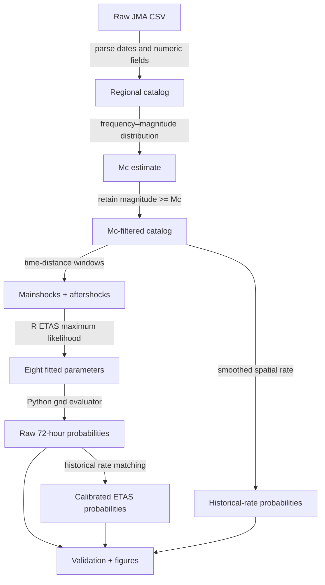

# Getting started

This guide is for someone seeing the repository for the first time. It explains what must be supplied, what each command does, and where to find the result.

## 1. Prepare the input catalog

The repository does not redistribute the raw JMA catalog. Download the relevant JMA Unified Hypocenter Catalog data from the [Japan Meteorological Agency](https://www.data.jma.go.jp/svd/eqev/data/bulletin/hypo_e.html) and save a CSV as:

```text
data/raw/jma_tohoku_2010_2023.csv
```

The loader currently expects these exact columns:

| Column | Meaning | Example |
|---|---|---|
| `Date` | Origin date | `2023-12-28` |
| `Time` | Origin time | `03:13:21` |
| `Latitude(°N)` | Latitude in degrees north | `38.25` |
| `Longitude(°E)` | Longitude in degrees east | `142.10` |
| `Depth(km)` | Hypocentral depth | `40.0` |
| `Mag` | Earthquake magnitude | `4.2` |

Before running the pipeline, check that the file contains the expected date range and that numeric fields do not contain unhandled formatting. The loader drops rows with invalid required values and reports how many were dropped.

## 2. Choose an execution environment

### Option A: Docker

Docker is the most repeatable option because it packages Python, R, system libraries, and the R `ETAS` dependency:

```bash
docker compose build
docker compose run --rm jma-etas-benchmark
```

The default fit uses 11 ETAS iterations so the example is practical to run. For a more thorough fit, use:

```bash
docker compose run --rm -e ETAS_NO_ITR=300 jma-etas-benchmark
```

### Option B: local Python and R

```bash
python3 -m venv .venv
source .venv/bin/activate
pip install -r requirements.txt
Rscript -e "install.packages('ETAS', repos='https://cloud.r-project.org')"
bash run_pipeline.sh
```

The local route requires Python 3.10+, R 4.2+, and build/system libraries suitable for the R package. If the R package cannot be installed, preprocessing and the historical-rate baseline can still be run independently, but the ETAS fit and complete pipeline cannot.

## 3. Run individual stages

Run the stages in this order when debugging or inspecting intermediate artifacts:

```bash
python3 src/01_load_and_filter.py
python3 src/02_estimate_mc.py
python3 src/03_decluster.py
Rscript etas/fit_etas.R
python3 src/04_etas_forecast.py
python3 src/calibrate_etas.py
python3 src/07_simple_forecast.py
python3 src/05_visualize.py
python3 src/06_validate.py
```

The shell script [`run_pipeline.sh`](../run_pipeline.sh) runs the same sequence with progress messages and fail-fast behavior (`set -euo pipefail`).

## 4. Understand the processing stages



### What each stage means

1. **Load and filter:** standardizes columns, parses timestamps, and keeps events between 2010–2023 inside 36–42°N and 140–146°E.
2. **Estimate Mc:** finds the maximum-curvature magnitude and adds 0.2 as a conservative offset. Events below the resulting threshold are not used downstream.
3. **Decluster:** applies magnitude-dependent Gardner–Knopoff windows to label likely dependent events. The mainshock catalog is used for the ETAS fit; both outputs are retained for auditability.
4. **Fit ETAS:** estimates background rate, productivity, temporal decay, magnitude sensitivity, and spatial decay parameters in R.
5. **Forecast:** evaluates a conditional intensity on a 0.1° grid, integrates three days, and applies `P(N >= 1) = 1 - exp(-lambda)` per grid cell.
6. **Calibrate:** rescales the total predicted rate to the historical catalog rate and writes a separate calibrated artifact. This is a documented benchmark correction, not prospective validation.
7. **Baseline:** uses smoothed historical event density and no short-term triggering.
8. **Visualize:** creates the forecast map with observed M4+ events.
9. **Validate:** compares each available forecast with events in its own metadata-defined time window.

## 5. Find the results

| Result | Path | Format |
|---|---|---|
| Regional catalog | `data/processed/catalog_region_2010_2023.csv` | CSV |
| Mc-filtered catalog | `data/processed/catalog_mc_filtered.csv` | CSV |
| Mainshocks | `data/processed/mainshocks_gk.csv` | CSV |
| Aftershocks | `data/processed/aftershocks_gk.csv` | CSV |
| ETAS parameters | `data/outputs/etas_parameters.csv` | CSV |
| Raw forecast | `data/outputs/forecast_prob_72h.npy` | NumPy array |
| Calibrated forecast | `data/outputs/etas_calibrated_prob_72h.npy` | NumPy array |
| Historical baseline | `data/outputs/simple_prob_72h.npy` | NumPy array |
| Grid metadata | `data/outputs/*_grid_metadata.json` | JSON |
| Skill scores | `data/outputs/validation_metrics.txt` | Key/value text |
| Figures | `figures/*.png` | PNG |

Always read a forecast's matching metadata JSON. It defines the latitude/longitude coordinates and the forecast start/end; the `.npy` array by itself does not.

## 6. Configuration knobs

The complete pipeline exposes the most important ETAS fitting controls as environment variables:

| Variable | Default | Purpose |
|---|---:|---|
| `ETAS_MIN_MAG` | `4.0` in `run_pipeline.sh` | Minimum magnitude passed to the R fit |
| `ETAS_NO_ITR` | `11` | ETAS optimization iterations |
| `ETAS_VERBOSE` | `false` | Verbose R fitting output |
| `ETAS_SEED` | `1` | Base random seed for repeatability |
| `ETAS_MAX_ATTEMPTS` | `5` | Retry count for failed R fits |
| `ETAS_FIT_START` | `2010-01-01` | Fit start date |
| `ETAS_FIT_END` | `2023-12-31` | Fit end date |
| `ETAS_MAX_EVENTS` | `0` | Optional cap; `0` means no cap |

Example:

```bash
ETAS_NO_ITR=300 ETAS_SEED=7 bash run_pipeline.sh
```

The region, grid spacing, and 72-hour horizon are currently constants in the Python and R scripts. If you change them, update all dependent scripts and metadata expectations together; central configuration is a planned simplification.

## 7. Reproducibility checklist

Before comparing two runs, record:

- the exact raw catalog and its source/download date;
- the values in `data/outputs/mc_estimate.txt`;
- ETAS environment variables and R/package versions;
- the forecast metadata JSON next to each grid;
- the validation metrics and generated figures.

A passing command is not enough evidence of scientific validity. For interpretation, read [`BENCHMARKS.md`](BENCHMARKS.md) and [`../METHODS.md`](../METHODS.md), especially the limitations around single-window validation, Mc, declustering, and post-hoc calibration.
