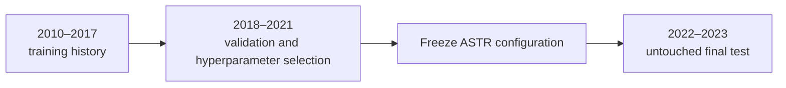

# Adaptive Spatiotemporal Rate model

## Purpose

The repository now includes a trainable research model called **Adaptive Spatiotemporal Rate (ASTR)**. It is designed to test whether short-term, training-only activity information improves on the long-term historical-rate baseline.

ASTR is an interpretable ETAS-inspired model, not a new implementation of the full R `ETAS` package and not a replacement for operational USGS aftershock forecasting systems.

## Architecture

```mermaid
flowchart LR
    A[Training catalog\ndatetime <= origin] --> B[Long-term spatial field\nGaussian smoothing]
    A --> C[Recent event field\nexponential time decay]
    A --> D[Magnitude activity\nexp(beta(M-Mc))]
    B --> E[Stable spatial prior]
    C --> F[Recent spatial distribution]
    D --> G[Activity multiplier]
    E --> H[ASTR expected counts]
    F --> H
    G --> H
    H --> I[72-hour 60x60 grid]
    I --> J[Poisson scores]
```

For each forecast origin, ASTR uses only events at or before that origin.

### Components

1. **Long-term spatial field**
   - Smooths all training events with a 0.4° Gaussian kernel.
   - Provides the stable geographic prior.

2. **Recent spatial field**
   - Uses events from a configurable recent window.
   - Applies exponential time decay with a learned time scale.
   - Concentrates the forecast near recent activity without treating every event equally.

3. **Magnitude activity weighting**
   - Applies `exp(beta × (magnitude − Mc))` to recent events.
   - The magnitude gain is learned only on the validation block.

4. **Spatial mixture**
   - Blends long-term and recent spatial distributions.

5. **Rate mixture**
   - Adjusts the long-term expected count using the normalized recent activity level.
   - The multiplier is clipped to a predeclared safe range to prevent a single event from creating an unbounded forecast.

The output is an expected count per cell. It is converted to a probability using:

```text
P(at least one event) = 1 - exp(-expected_count)
```

## Training protocol

The model does not use a random train/test split. Earthquake forecasting is temporal, so the experiment is chronological:



The current experiment uses:

| Setting | Value |
|---|---|
| Forecast horizon | 72 hours |
| Origin spacing | 3 days; windows do not overlap |
| Validation origins | 487 |
| Tuning origins | Every fourth validation origin; 122 origins |
| Final test origins | 243 |
| Training rule | `datetime <= forecast_origin` |
| Scoring rule | `forecast_origin < datetime <= forecast_end` |
| Grid | 60×60 cells, 61×61 coordinate edges |
| Candidate search | 108 predeclared combinations |

Selected configuration for the checked-in run:

| Parameter | Value |
|---|---:|
| Recent window | 90 days |
| Recent decay time | 14 days |
| Magnitude gain | 0.0 |
| Spatial mixture | 0.25 |
| Rate mixture | 0.75 |
| Long-term bandwidth | 0.4° |
| Recent bandwidth | 0.2° |

The zero magnitude gain is itself a useful finding: within this validation design, adding magnitude weighting did not improve the selected validation likelihood. It should not be changed after looking at the final test results.

## Benchmark relationship

The real-world operational class used for context is ETAS. The USGS [Operational Aftershock Forecasting system](https://earthquake.usgs.gov/data/oaf/overview.php) uses information from past aftershock sequences, and the USGS documents ETAS-based aftershock forecasting as part of its operational research and products.

ASTR is compared directly only with models that can be evaluated on the same JMA catalog, region, grid, and rolling origins:

- `uniform_rate`: a training-only uniform spatial rate;
- `historical_rate`: a training-only smoothed spatial rate;
- `ASTR`: the proposed adaptive model.

A direct claim that ASTR beats USGS OAF or UCERF3-ETAS would be invalid without the same catalog, region, target magnitudes, forecast products, and prospective testing protocol. The current result instead asks a defensible local question: does ASTR beat the repository's reproducible historical-rate benchmark on held-out JMA windows?

## Reproducible command

```bash
python3 src/09_train_adaptive_model.py
```

Outputs:

```text
data/outputs/adaptive_model_config.json
data/outputs/adaptive_model_tuning.csv
data/outputs/adaptive_backtest_windows.csv
data/outputs/adaptive_backtest_summary.json
data/outputs/adaptive_backtest_reliability.json
figures/adaptive_backtest.png
```

## Limitations

- ASTR is a compact research model, not full ETAS. It does not estimate a branching process or explicitly model parent-child triggering.
- The model uses a global Mc=0.8 threshold and does not correct spatial or short-term detection incompleteness.
- The validation and test blocks are from one region and one catalog. Generalization is unknown.
- The final test result is a benchmark result, not a guarantee of future performance.
- ASTR has not been compared fairly with a rolling, origin-safe R ETAS fit because R is unavailable in the current sandbox and the existing ETAS artifact uses a retrospective fit.
